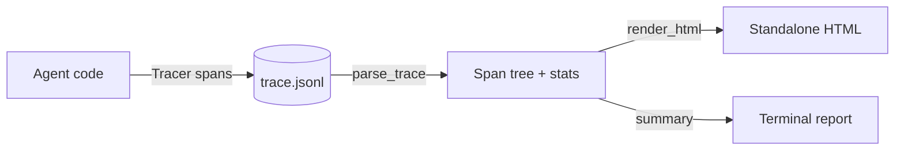

# agent-trace-viewer

Record tool-calling agent runs as JSONL traces and render them as a self-contained HTML timeline. Standard library only.

## Why

When an agent loops through model calls and tool calls, plain logs make it hard to see the order of steps, which one was slow, and which one failed. Hosted tracing tools need accounts and network access. This project records a run to a local JSONL file and turns it into one HTML file you can open offline or attach to a ticket.

## Demo

The offline mock agent runs a scripted task. One tool call times out and is retried, so the failure shows up in the trace:

```text
$ python3 -m agent_trace_viewer demo
agent answer: Add jitter to retries, set deadlines on calls; billing-api is healthy; budget is 49.
trace: demo.jsonl
report: demo.html
duration   6.56s
spans      11
errors     1
unfinished 0
  event    1 spans  0.00s
  llm      5 spans  3.40s
  run      1 spans  6.56s
  tool     4 spans  3.16s
slowest    tool:fetch_status (1.60s)
! tool:fetch_status at 1.75s - TimeoutError: billing-api did not respond within 1.2s
```

Open `demo.html` for the timeline: one row per span with a duration bar, error spans in red, a filter for errors only, and a detail panel with each span's input, output and error. The files from this run are in [`examples/`](examples/).

## Quick start

```bash
PYTHONPATH=src python3 -m agent_trace_viewer demo
```

Needs Python 3.9 or newer. Optionally install it with `pip install -e .` to get the `agent-trace-viewer` command. To render a trace from your own agent:

```bash
agent-trace-viewer render my-run.jsonl --out my-run.html
agent-trace-viewer summary my-run.jsonl
```

Recording from your own code:

```python
from agent_trace_viewer import Tracer

with open("my-run.jsonl", "w") as f:
    tracer = Tracer(f)
    with tracer.span("run", "my-agent", {"task": "..."}):
        with tracer.span("tool", "search", {"q": "..."}) as span:
            span.set_result("...")
```

## How it works



The tracer appends a `start` line and an `end` line per span and flushes each one. The loader pairs them into a tree, marks spans that never ended as unfinished, and computes per-kind totals and the slowest step. The renderer embeds the data as JSON in one HTML file and draws it with a small inline script. The trace format is documented in [docs/DESIGN.md](docs/DESIGN.md).

## Design decisions

- **Start/end lines in JSONL**: a crashed run still leaves a readable trace with its open spans visible. See [docs/DESIGN.md](docs/DESIGN.md).
- **Standard library only**: no install friction and nothing to audit.
- **Static HTML**: one file works offline. It is not virtualised, so it targets single runs rather than huge traces.
- **Injectable clock**: tests and the demo are deterministic and never sleep.
- **Escaped output**: trace content is embedded as JSON with `<`, `>` and `&` escaped and written to the page with `textContent`, so a trace cannot inject markup.

## Running tests

```bash
PYTHONPATH=src python3 -m unittest discover -s tests -v
```

Built with Claude Code, reviewed by Naman Jain.
